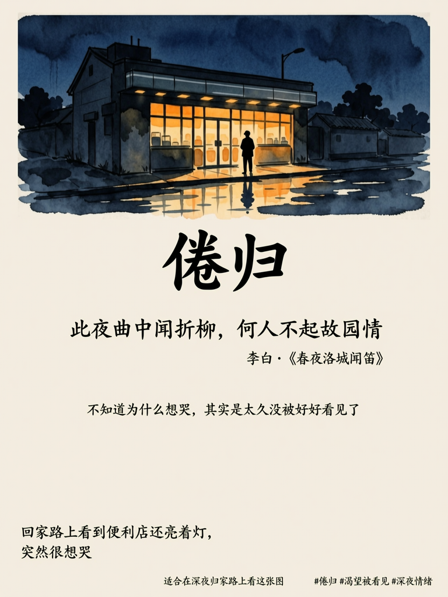
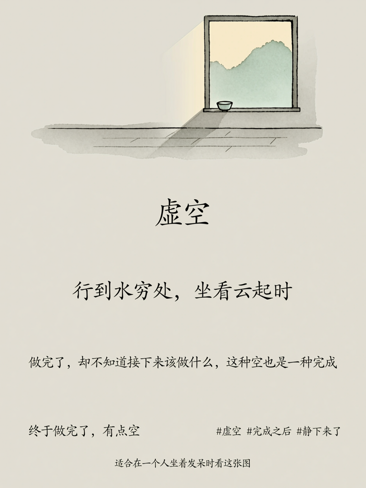
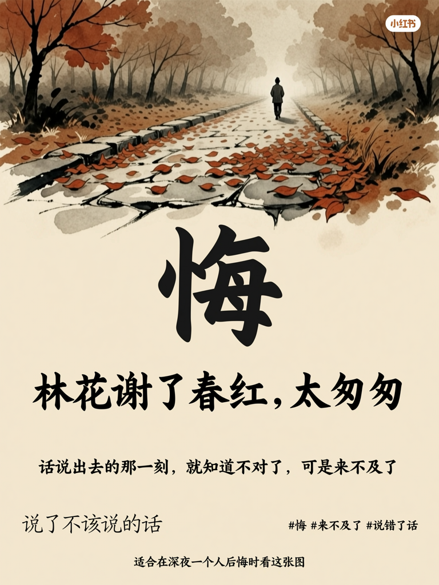

# llm-skills

基于万相2.7（Wan2.7）API 构建的 Skill 合集，参赛作品来自 WaytoAGI「万相妙思+」快闪赛。

---

## 📦 Skill 列表

### 海报生成器 v1.0

> 一句心情，一张海报。

通过六层深度情绪诊断，将用户的一句口语化心情描述，转化为具有中国诗意美学的水墨意境海报。

**诊断链路：** 表层情绪 → 深层情绪 → 情绪意象 → 诗词共鸣 → 色彩映射 → 视觉方案

**海报模块（7个）：**
- 情绪标题（书法大字）
- 意境句（古诗词匹配）
- 主视觉（水墨意象场景）
- 情绪注解（温柔解读）
- 心声留白（用户原话/Skill生成）
- 情绪标签（#话题标签）
- 情绪时区（适合在___时刻看这张图）

**使用模型：** `wan2.7-image-pro` / `wan2.7-image`

📄 [查看完整 Skill 文档](skill/skill.md)

---

## 🖼 效果展示

| 倦归 · 深夜孤独 | 虚空 · 完成后的空 | 悔 · 说错话后的焦灼 |
|:---:|:---:|:---:|
|  |  |  |
| `今天加班到很晚，回家路上` `看到便利店还亮着灯，` `突然很想哭` | `今天终于做完了` `一件拖了很久的事，` `有点空` | `和朋友吵架了，` `说了不该说的话` |

---

## 🚀 快速开始

### 1. 安装依赖

```bash
poetry install
```

### 2. 配置 API Key

在项目根目录创建 `.env` 文件：

```
DASHSCOPE_API_KEY=your-api-key
```

> 获取 API Key：[阿里云百炼控制台](https://bailian.console.aliyun.com/) → API-KEY管理

### 3. 生成演示图

```bash
poetry run python generate_demo.py
```

生成图片保存至 `assets/` 目录。

---

## 📁 目录结构

```
llm-skills/
├── skill/
│   └── skill.md          # 完整 Skill 文档（可直接上传到 Workbuddy）
├── submission/
│   ├── skill.md          # 参赛提交版本
│   ├── 提交表单.md        # 飞书表单填写内容
│   └── assets/           # 提交用效果图
├── assets/               # 万相2.7实际生成的演示图
├── generate_demo.py      # 生图脚本
└── pyproject.toml
```

---

## 🏆 参赛信息

- 赛事：WaytoAGI 整活计划第十二期「万相妙思+」快闪赛
- 主题：万相皆可 Skill
- 提交截止：2026年4月15日 23:59
