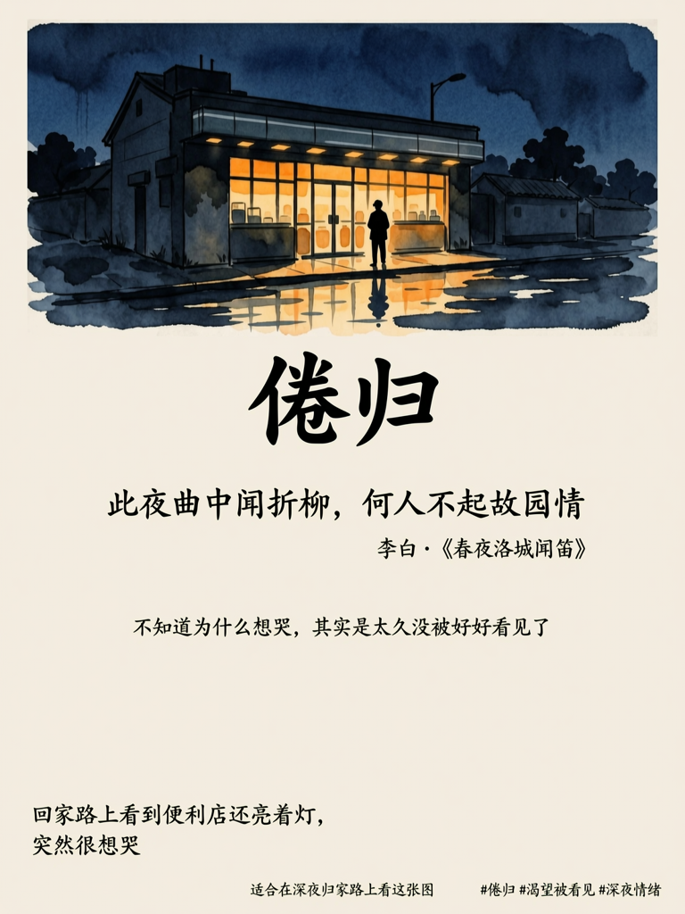
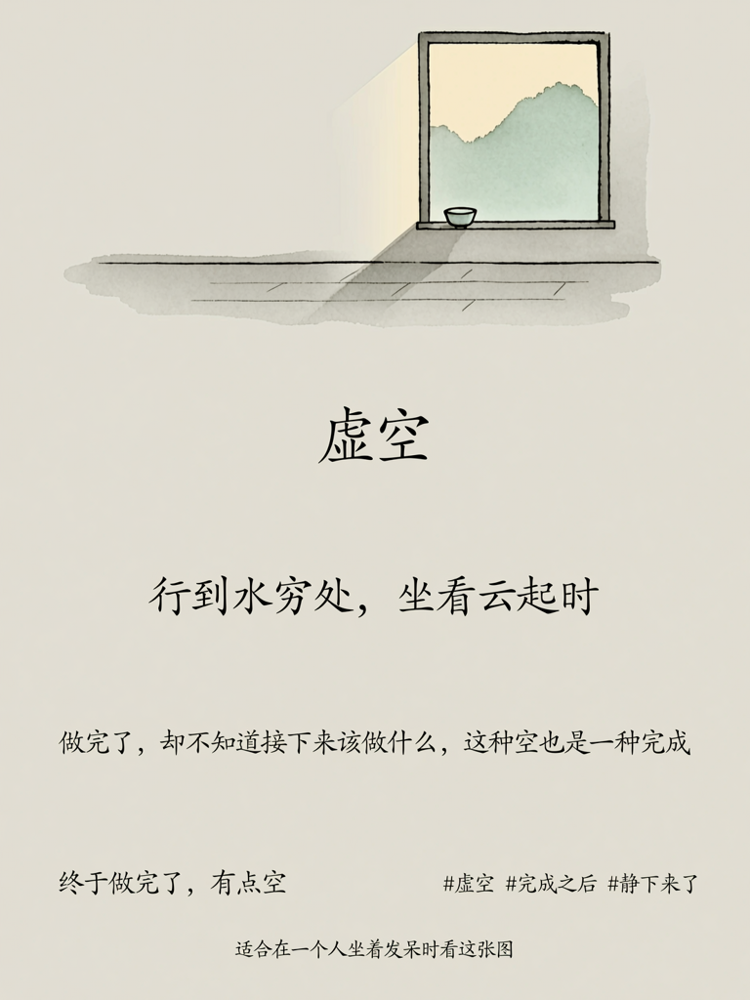
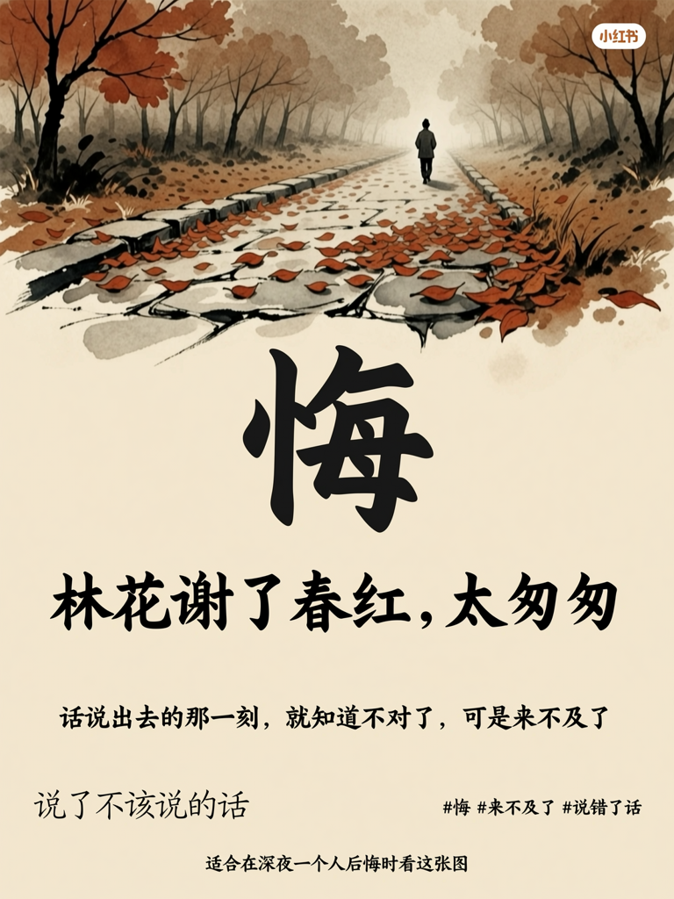

# 万相妙思快闪赛 · 提交表单

> 提交地址：https://waytoagi.feishu.cn/share/base/form/shrcn1enS88uDx9Ceogjh10MROh
> ⚠️ 以下内容按飞书表单字段顺序整理，直接复制填入即可

---

## 作品名称

情绪意境海报生成器

---

## 作品简介

一句心情，一张海报。

通过六层深度情绪诊断（表层情绪→深层情绪→情绪意象→诗词共鸣→色彩映射→视觉方案），将用户的一句口语化心情描述，转化为具有中国诗意美学的水墨意境海报。调用万相2.7文生图能力（wan2.7-image-pro）生成，内置情绪标签与"情绪时区"（适合在___时刻看这张图）两个差异化模块。

---

## 解决什么问题 / 面向什么场景

**问题：**
人在情绪复杂的时刻，往往说不清楚自己的感受，也找不到一个合适的出口去表达和传递。

**场景：**
- 深夜加班回家、想哭却不知道为什么
- 做完一件事之后的空洞感
- 和朋友吵架后的悔意

**本 Skill 的价值：**
用一句话描述心情，Skill 会帮你「读懂」情绪，匹配对应的古诗词意境，并生成一张可以发小红书、可以留给自己的情绪海报。不只是"出一张图"，而是让用户感到被看见、被表达、被传递。

---

## 核心调用逻辑

```
用户输入一句话
    ↓
步骤1 启动询问：收集心情描述 + 可选风格偏好
    ↓
步骤2 信息提取：识别情绪关键词、强度、触发场景、心理需求
    ↓
步骤3 价值提炼（六层情绪深度诊断）：
    表层情绪 → 深层情绪 → 情绪意象 → 诗词匹配 → 色彩映射 → 视觉方案
    ↓
步骤4 智能拆分：确定7个海报模块内容
    ↓
步骤5 内容生成：输出诊断报告 + 完整生图 Prompt
    ↓
步骤6 用户确认 → 调用 wan2.7-image-pro 执行生图
    ↓
输出：一张水墨意境情绪海报（3:4竖版）
```

---

## 使用到的 Wan 能力

| 能力 | 模型 | 说明 |
|---|---|---|
| 文生图（Text-to-Image） | `wan2.7-image-pro` | 主力生图模型，0.5元/张 |
| 备选标准版 | `wan2.7-image` | 0.2元/张，速度更快 |
| 图像比例 | `3:4`（768×1024） | 竖版，适配小红书 |

---

## Prompt / 工作流 / 配置说明

完整 Skill 文档见附件 `skill.md`，包含：
- 完整六步工作流
- 七模块海报结构规范
- 完整 Prompt 模板（8段结构，含所有填充变量）
- 三个端到端完整示例（含实体 Prompt）

**Prompt 结构摘要（8段）：**
1. `OVERALL VISUAL CONCEPT` — 整体视觉概念：水墨意境、诗意情感、非商业海报
2. `COLOR SYSTEM` — 配色方案：宣纸底色+情绪主色+深炭墨
3. `LAYOUT & STRUCTURE` — 布局：上方40%水墨场景+书法标题+诗句+注解+时区+标签
4. `GRAPHIC ELEMENTS` — 图形语言：水墨笔触、书法字、自然意象、宣纸纹理
5. `MODULE REQUIREMENTS` — 7个模块逐一定义
6. `TYPOGRAPHY STYLE` — 排版：行楷标题+行书诗句+宋体注解+手写心声
7. `WHAT TO AVOID` — 禁忌：动漫/霓虹/商业感/纯白背景
8. `CONTENT FOR THIS IMAGE` — 动态内容填充（每次生成时替换）

---

## 效果对比展示

### Before（用户输入）
> 纯文字，无视觉呈现

### After（Skill 生成）

**示例1：倦归 · 深夜孤独**
输入：`今天又加班到很晚，回家路上看到便利店还亮着灯，突然很想哭，也不知道为什么。`



---

**示例2：虚空 · 完成后的空**
输入：`今天终于做完了一件拖了很久的事，有点空。`



---

**示例3：悔 · 说错话后的焦灼**
输入：`和朋友吵架了，说了不该说的话。`



---

## 关键代码 / 仓库说明

**GitHub 仓库：** https://github.com/ZouShuangDian/llm-skills

**目录结构：**
```
情绪意境海报生成器/
├── SKILL.md              # 完整 Skill 定义（六步工作流 + 七模块 + Prompt 模板）
├── references/
│   └── common.md        # API Key 配置说明
└── scripts/
    └── generate.py      # 独立生图脚本
```

**核心生图脚本（scripts/generate.py）关键逻辑：**
```python
# 调用万相2.7文生图接口
payload = {
    "model": "wan2.7-image-pro",
    "input": {
        "messages": [
            {"role": "user", "content": [{"text": prompt}]}
        ]
    },
    "parameters": {
        "size": "768*1024",   # 3:4 竖版，适配小红书
        "n": 1,
        "watermark": False,
        "thinking_mode": True,
    }
}
resp = requests.post(IMG_URL, headers=headers, json=payload, timeout=300)
```

**使用方式：**
```bash
# 安装依赖
pip install requests python-dotenv

# 配置 API Key
export DASHSCOPE_API_KEY="your-api-key"

# 生成海报（将完整 Prompt 传入 --prompt 参数）
python scripts/generate.py \
  --prompt "Create a Chinese ink-wash poster about 「倦归」..." \
  --size 768*1024 \
  --output ./output
```

---

## 演示内容链接

| 内容 | 链接 |
|---|---|
| 演示视频 | https://www.xiaohongshu.com/discovery/item/69db58e40000000023025817 |
| 图文教程 | https://www.xiaohongshu.com/discovery/item/69db5a3e000000001b001cc9 |

---

## 联系方式

| 字段 | 内容 |
|---|---|
| 手机号 / 微信号 | 13456109135 |

---

## 社交媒体发布 Tag（必须带，是获奖条件之一）

```
#Wan #万相妙思快闪赛 #通义实验室 #WaytoAGI
```
